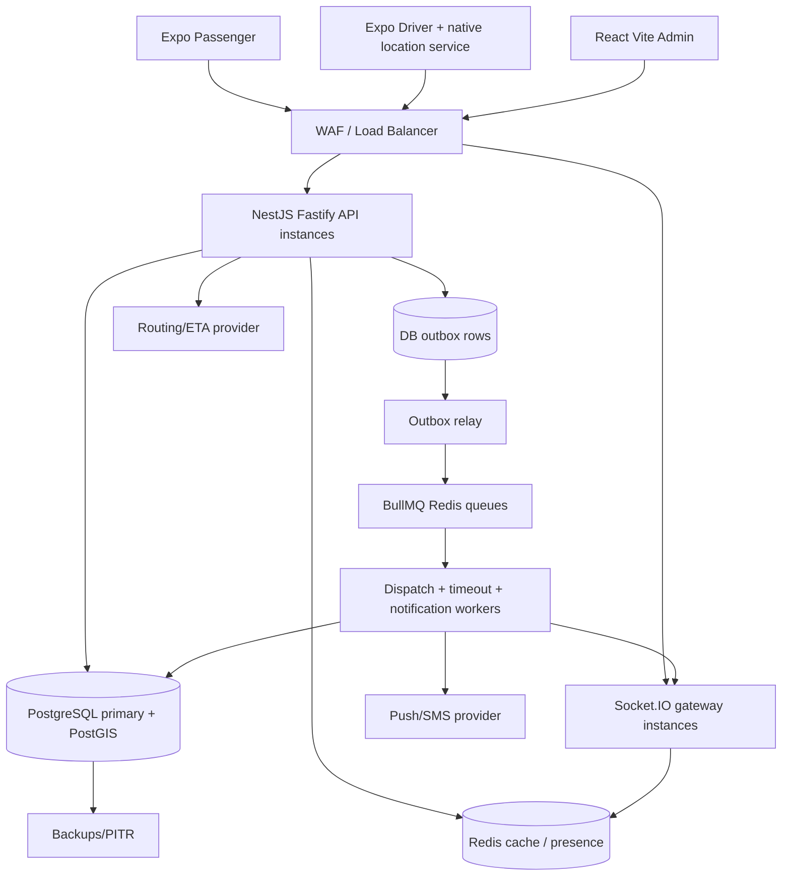

# Architecture — Modular Monolith + Dedicated Worker

## Why this architecture
A high-reliability transactional system needs durable booking state, live location transport, and separately managed background work. Horizontal scaling should not multiply competing assignment decisions.



## Service boundaries
- **identity:** OIDC tokens, users, memberships, RBAC, session invalidation.
- **tenant:** operator metadata, regulatory eligibility, service zones, fleet policies.
- **drivers:** profile, verification, vehicle links, active availability, location ingest.
- **terminals:** geofence, approved shifts, queue entries, queue events and override workflow.
- **booking:** quote, ride creation, transitions, cancellations, receipts.
- **dispatch:** strategies, candidate ranking, offers, timeouts, fallback, retries.
- **pricing:** versioned deterministic fare and receipt breakdown, currencies.
- **safety:** incident reporting, contact controls, support access, retained evidence.
- **events:** transactional outbox, WebSocket notifications, push and audit.

## Code repository target
```
apps/passenger/            Expo Router React Native + TypeScript passenger app
apps/driver/               Expo Router React Native + TypeScript driver app
apps/admin/                React + Vite admin SPA
services/api/              NestJS HTTP API and WebSocket gateway
services/dispatch-worker/  Separate BullMQ + outbox relay worker processes
packages/contracts/        Versioned OpenAPI schemas + generated TypeScript types
packages/design-tokens/    Versioned styling primitives
infrastructure/            IaC/CD once hosting is chosen
```

## Data flow
1. Passenger posts a ride request with idempotency key.
2. API verifies authenticated actor, tenant/service, quote, location and active-booking constraint.
3. One DB transaction writes ride, ride_event and outbox record.
4. Relay publishes a dispatch job; worker queries PostGIS + tenant eligibility and routing ETA.
5. Worker transaction reserves a single eligible driver via `ride_offers` and optional queue entry reservation; emits outbox event.
6. Realtime gateways and push publish the offer. Driver acceptance validates offer expiry, ride state and driver eligibility under row locks.
7. DB commits assignment and ride event. UI receives event but always reconciles against GET /rides/{id}.
8. Timers expire offers by DB time; reaper recovers lost jobs and stale reservations.

## Consistency model
- PostgreSQL is the only source of truth for ride state, pricing, offers and terminal queue membership.
- Redis presence/coordinates are cache data, not authoritative eligibility or booking state.
- Use row-level locks and unique partial indexes for double assignment prevention.
- Use outbox to bridge DB commit and job/realtime notification; at-least-once delivery, idempotent consumers.
- Avoid distributed transactions; external payment confirmation uses an inbox + state reconciliation.

## Scaling
- Scale stateless API and socket gateway independently; use Redis Socket.IO adapter.
- Partition or retain GPS event history separately; avoid one DB write per view subscriber.
- Rate-limit location ingest, batch telemetry and route ETA calculations, cache route results appropriately.
- Add read replicas for reporting only; never dispatch against eventually consistent replicas.
- Introduce location partitions or database sharding only after measuring bottlenecks.

## Provider portability
Use adapters for routing, push, SMS, storage, identity and payments. Consider Supabase Postgres/Storage as a managed option, but do not allow mobile clients to write ride/queue records directly.

## Disaster behavior
If database write unavailable: new booking disabled with clear message. If Redis unavailable: recoverable in-flight rides remain in DB; dispatch and sockets degrade gracefully. If map/routing fails: no invented accurate ETAs; show unavailable or estimate with explicit label and server policy.
