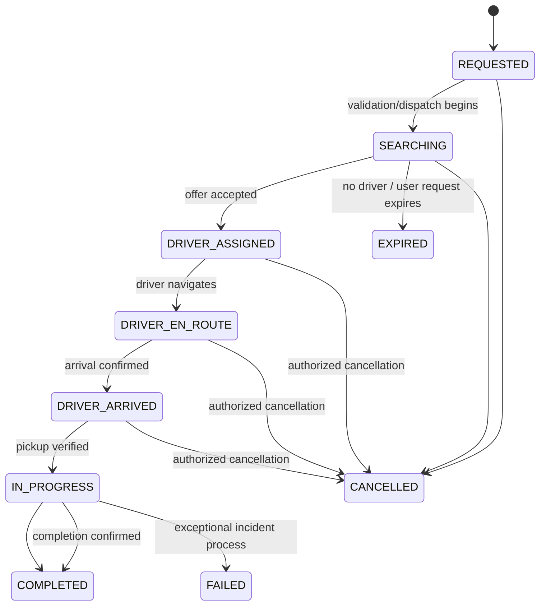

# Ride Lifecycle — Server-enforced State Machine

## Ride states
`REQUESTED` → `SEARCHING` → `DRIVER_ASSIGNED` → `DRIVER_EN_ROUTE` → `DRIVER_ARRIVED` → `IN_PROGRESS` → `COMPLETED`.

Terminal and on-demand rides share this lifecycle. `OFFERED` is deliberately **not** a ride state: it belongs to `ride_offers` so a ride can search through multiple timed offers without an inconsistent ride lifecycle.

Terminal states: `WAITING`, `RESERVED`, `CONSUMED`, `LEFT`, `PAUSED`.
Offer states: `PENDING`, `ACCEPTED`, `DECLINED`, `EXPIRED`, `REVOKED`.
Ride terminal states: `COMPLETED`, `CANCELLED`, `EXPIRED`, `FAILED`.

## Server guard matrix
| Action | Actor | Allowed from | Critical validations |
| --- | --- | --- | --- |
| request | passenger | no active ride | zone, service, quote, idempotency |
| dispatch | worker | REQUESTED/SEARCHING | policy, tenant and deadline |
| accept offer | offered driver | SEARCHING | pending+unexpired, driver+vehicle eligible |
| en-route | assigned driver | DRIVER_ASSIGNED | assignment owner |
| arrived | assigned driver | DRIVER_EN_ROUTE | pickup proximity or justified override |
| start trip | assigned driver | DRIVER_ARRIVED | passenger confirmation/PIN policy, not just GPS |
| complete | assigned driver | IN_PROGRESS | settlement readiness, terminal events |
| cancel | authorized passenger/driver/admin | non-terminal, policy-specific | reason, fee preview if applicable, audit |
| fail | safety/support admin | exceptional live states | incident ID, approval, audit |

## Guardrails
- Reject transition not on allowlist with `409 INVALID_RIDE_TRANSITION`.
- Use expected state/version compare-and-swap in transactions; treat duplicate same-key requests idempotently.
- A late accept must fail after offer deadline even when mobile UI still shows button.
- An offline driver reconnect must fetch server state before showing action controls.
- Payment failure after ride completion is a `payment` state, not a reason to revert a completed ride.
- Manual recovery transitions require elevated permission and incident reference.

## Events
`ride.requested`, `ride.searching`, `offer.created`, `offer.expired`, `offer.accepted`, `ride.assigned`, `driver.arrived`, `ride.started`, `ride.completed`, `ride.cancelled`, `queue.joined`, `queue.reserved`, `queue.released`, `safety.incident_created`.

## Idempotency
Each actionable command carries `Idempotency-Key` and actor scope, request payload hash, TTL and result snapshot. The server rejects reuse of the same key with a different payload.

## Shared and Reservation overlay states
- A **Shared** trip group has a separate group lifecycle; multiple passenger rides can be within one group with individual board/alight events. The group is not equivalent to one passenger's `ride.status`; see `docs/26-SHARED-POOLING.md`.
- **Special** uses the same exclusive-ride state machine plus individually tracked itinerary-stop states; see `docs/27-SPECIAL-ITINERARIES.md`.
- **Reservation** uses `HELD`, `CONFIRMED`, `CHECKED_IN`, `DISPATCHING`, `ASSIGNED`, `FULFILLED`, `CANCELLED`, `EXPIRED`, `NO_SHOW`, `UNFULFILLED`, `RESCHEDULED`, `REJECTED` and should **not** be inserted into ride states. See `docs/28-TODA-RESERVATIONS.md`.
